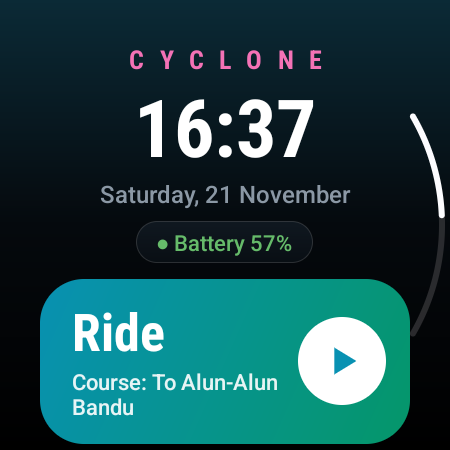
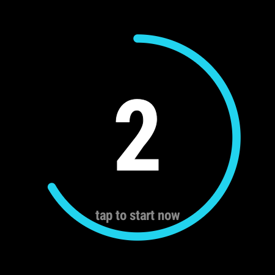
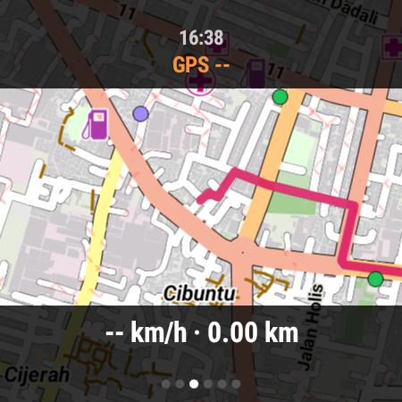
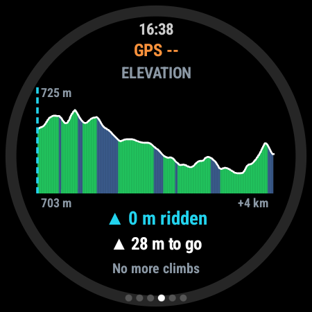
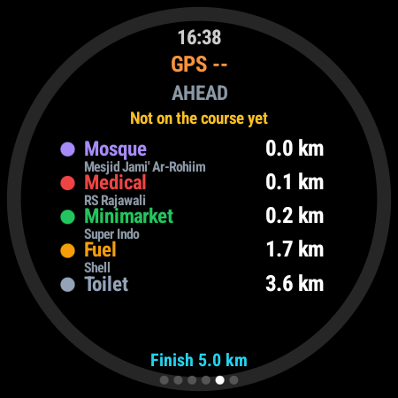
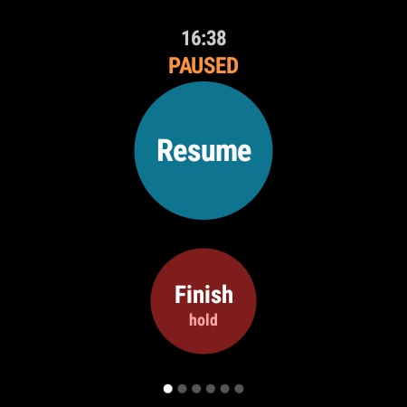
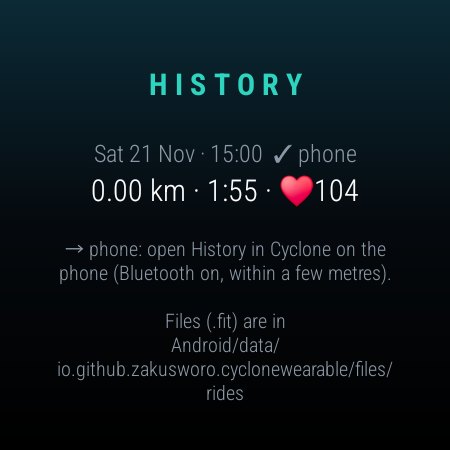
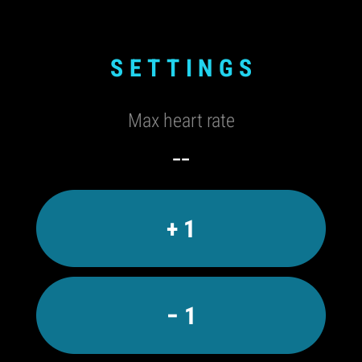

# Cyclone-Wearable: install and use

Cyclone-Wearable is Cyclone's bike computer for **Wear OS** watches. It records rides on the watch alone
(GPS, wrist heart rate, barometer, .fit file), shows an offline map, elevation, stops ahead and turn cues for a
course from the Cyclone phone app, and can also act as a Bluetooth heart-rate strap for Cyclone on a phone.

Beta: tested on one Samsung Galaxy Watch5 (Wear OS 6). Report problems to the Cyclone tester group.

## Screenshots (Galaxy Watch5)

| | | | |
|---|---|---|---|
| <br>Home | <br>Week goal, tiles | <br>Start countdown | <br>Ride |
| <br>Offline map + course | <br>Elevation | <br>Stops ahead | <br>Heart rate |
| <br>Controls | <br>Paused | <br>Finish: Save / Discard | <br>History |
| <br>Options | <br>HR strap for the phone |

## Will it work on my watch?

Cyclone-Wearable needs a **Wear OS 3 or newer** watch **with GPS** and Wi-Fi (for installing). Fitness bands
(Galaxy Fit, Xiaomi / Mi Band, Fitbit Charge, Huawei Band, Amazfit Band) don't run Wear OS.

| Brand | Watches | Wear OS | Install method (see below) | Tested |
|---|---|---|---|---|
| Samsung | Galaxy Watch4, Watch4 Classic | 3 → updated to 4/5/6 | **B** (after the update) or **A** (still on Wear OS 3) | |
| Samsung | Galaxy Watch5, Watch5 Pro | 3.5 → 4/5/6 | **B** | ✓ Watch5 44 mm, Wear OS 6 |
| Samsung | Galaxy Watch6, Watch6 Classic, Watch7, Watch Ultra, Watch FE, Watch8, Watch8 Classic | 4 and newer | **B** | |
| Google | Pixel Watch, Pixel Watch 2, 3, 4 | 3.5 → 4/5/6 | **B** | |
| Mobvoi | TicWatch Pro 5, Pro 5 Enduro, TicWatch 5 Pro, Atlas | 3 → 4 | **A** (Wear OS 3) or **B** (Wear OS 4+) | |
| Mobvoi | TicWatch Pro 3 Ultra (GPS model) | 3 | **A** | |
| OnePlus | Watch 2, Watch 2R, Watch 3 | 4 and newer | **B** | |
| Xiaomi | Watch 2, Watch 2 Pro | 3 → 4 | **A** or **B** | |
| Oppo | Watch X | 4 | **B** | |
| Fossil / Skagen | Fossil Gen 6, Skagen Falster Gen 6 (after their Wear OS 3 update) | 3 | **A** | |
| Montblanc | Summit 3 | 3 | **A** | |

Which method? Look at **Settings → Developer options** on the watch:
**Wireless debugging** with *Pair new device* = method **B**; **Debug over Wi-Fi** showing `IP:5555` = method **A**.
Not sure of your Wear OS version? **Settings → About watch → Software information** (or *Versions*).

**Won't work** (not Wear OS, or too old): Galaxy Watch 3, Watch Active / Active 2, Gear (Tizen); Wear OS 2 watches
(Fossil Gen 5 and older, TicWatch Pro 3 not updated); Apple Watch; Garmin; Coros; Polar; Suunto; Amazfit; Huawei;
Fitbit; Xiaomi / Mi Band. If your watch can **broadcast heart rate** (Garmin, Coros, Polar, Suunto, some Amazfit and
Huawei), Cyclone on the phone already pairs it as a heart-rate sensor: Cyclone → Sensors → Heart rate → Pair.

Only the Galaxy Watch5 has been tested; the others meet the requirements. Tell the tester group how it goes.

**Versions**: Cyclone-Wearable carries the same version and codename as the Cyclone phone app it ships with
(first: **0.18.0 "Vulcan"**, now **0.20.0 "Customs"**). Keep both on the same version. Sending rides from the watch to the phone and
courses from the phone to the watch need Cyclone **0.18.0 or newer** on the phone; with an older Cyclone the watch
still records and works as an HR strap.

## Install (one time, about 10 minutes)

The app is not on the Play Store, so it is installed over the watch's Wi-Fi debugging. None of these watches
take an app over the charging cable.

### 1. Turn on developer mode on the watch

1. Watch: **Settings → About watch → Software information** (Pixel / TicWatch / Fossil: **System → About**),
   tap **Software version** (or **Build number**) repeatedly until it says developer mode is on (5–7 taps).
2. **Settings → Developer options**: turn on **ADB debugging**.
3. Put the watch on the **same Wi-Fi** as the phone or PC (Settings → Connections / Connectivity → Wi-Fi), keep
   it **on its charger** (many watches switch Wi-Fi off when idle) and the screen awake.

### 2. Connect and install

Download **cyclone-wearable.apk** first: https://github.com/zakusworo/cyclone-wearable/releases/latest

#### Method A: Wear OS 3 ("Debug over Wi-Fi", port 5555)

1. Watch: **Developer options → Debug over Wi-Fi** on. Note the address, e.g. `192.168.1.10:5555`.
2. **From the phone:** in an installer app (**Bugjaeger Mobile ADB**, **Wear Installer 2** or **GeminiMan
   WearOS Manager**, Play Store) enter the IP and port `5555`, connect, **allow** the prompt on the watch
   ("Allow debugging?" → Always allow), then pick **cyclone-wearable.apk** and install.
3. **Or from a PC:**
   ```
   adb connect 192.168.1.10:5555      # allow the prompt on the watch
   adb install cyclone-wearable.apk
   ```

#### Method B: Wear OS 4 and newer ("Wireless debugging", pairing code)

1. Watch: **Developer options → Wireless debugging** on. Its page shows the watch's **IP and port**, e.g.
   `192.168.1.10:40123` (the port changes each time it is switched on).
2. Watch: **Wireless debugging → Pair new device**: it shows a **6-digit pairing code** and a **pairing port**
   (different from the port above).
3. **From the phone:** in the installer app choose *pair* / *wireless debugging pairing*, enter the IP, pairing port
   and code; then connect with the IP and the port from step 1; pick **cyclone-wearable.apk** and install.
   (Pick an installer updated for pairing codes: older ones only know method A and fail here.)
4. **Or from a PC:**
   ```
   adb pair 192.168.1.10:PAIRING_PORT PAIRING_CODE    # from "Pair new device"
   adb connect 192.168.1.10:PORT                       # from the main Wireless debugging page
   adb install cyclone-wearable.apk
   ```

"Success" = done. If it can't connect: same Wi-Fi? watch awake on the debugging page? Wi-Fi on the watch really
on (not only Bluetooth)? Try again right after switching debugging on.

### 3. Turn debugging off again

Wireless debugging uses battery: turn it off on the watch once the app is installed.

### 4. First start

Open **Cyclone-Wearable** (amber wheel) on the watch and tap **Ride**. Allow **location**, **heart rate /
sensors**, **notifications** and **nearby devices** (Bluetooth: for the phone link).

## Offline map (optional)

The Map page uses the same Mapsforge `.map` files as Cyclone on the phone. For now they are copied over Wi-Fi
debugging (a download on the watch itself is coming):

1. Get the map for your area: in Cyclone on the phone (Maps) it is in
   `Android/data/io.github.zakusworo.cyclone/files/maps/`, or from https://download.mapsforge.org/maps/v5/
   (Java: `asia/indonesia/java.map`, 918 MB).
2. From a PC: `adb push java.map /sdcard/Android/data/io.github.zakusworo.cyclonewearable/files/maps/`

Without a map the Map page draws the course line only. The watch needs the free space (see Settings → Storage).

## Using it

- **Ride**: tap the Ride card; 3-2-1 (tap to start now). Recording starts without waiting for GPS.
- **Pages**: Controls ← Ride → Map → Elevation → Ahead → Heart. Swipe sideways or turn the bezel; while
  recording they also switch by themselves every 5 s (Options → Auto page).
- **Pause**: swipe right to Controls → Pause. Auto-pause stops the timer when you stop.
- **Finish**: Controls → **hold Finish** 1 s → **Save** (or Discard, tap twice).
- **Course, map line, elevation, stops, turn cues**: pick a route in Cyclone on the phone (Routes) with
  Cyclone-Wearable open on the watch nearby; it arrives in a few seconds ("Course: …" on the Ride card).
- **Rides to the phone and Strava**: after saving, open **History** in Cyclone on the phone near the watch
  (Bluetooth on). The ride appears there; upload it with **Strava (web)** like any Cyclone ride.
- **Heart-rate strap for the phone**: watch → **Sensors → Start**; phone → Cyclone → Sensors → Heart rate → Pair.
- **Alerts**: turn cues, off course, climbs, eat / drink reminders, every km: buzz and sound. Options turns
  them on or off.

Raising your wrist during a ride returns to the ride. With always-on display enabled in the watch settings the
ride stays visible, dimmed.

## Updating

**From the next version on (0.18.1+), the watch updates itself:** it checks for a new version every few hours
(and when you open the app) over its Wi-Fi or the phone's connection, shows a notification, and the home screen's
bottom line turns green ("⬆ Update … available"). Tap it → **Update** → the first time, switch on **Install unknown
apps** for Cyclone-Wearable (the watch opens that setting) → confirm Android's **Update** prompt. Rides, settings
and maps stay. Cyclone on the phone (0.19.0+) also tells you when the watch app is older than the phone app.

**0.18.0** has no updater: install 0.19.0 once the same way as the first install; from then on it
updates by itself.

## Uninstall

Hold the app icon → Uninstall, or `adb uninstall io.github.zakusworo.cyclonewearable`. This deletes the rides
still on the watch and the map: send rides to the phone first.

## Known limits (beta)

- Wrist heart rate on a bike is less steady than a chest strap (grip, road buzz).
- Battery: GPS + heart rate for hours; expect roughly 4–6 h on a Galaxy Watch5 (not yet measured).
- Strava shows the ride as an unknown / development device (Samsung has no FIT maker id); the file says
  "Galaxy Watch5" as product name.
- Only one app can record a workout: stop Samsung Health or Strava workouts first.
