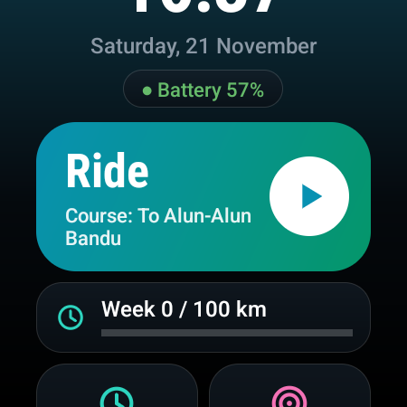
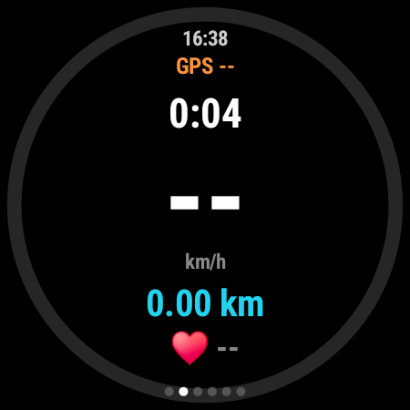
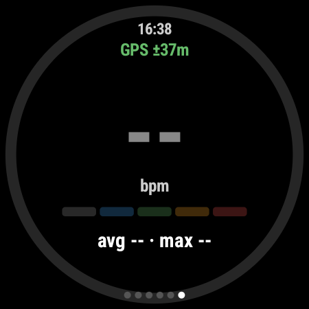
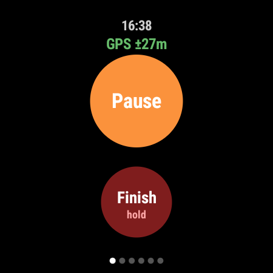
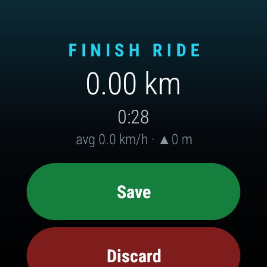
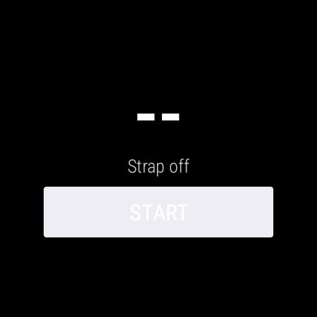

# Cyclone-Wearable: install and use

Cyclone-Wearable is Cyclone's bike computer for **Wear OS** watches. It records rides on the watch alone
(GPS, wrist heart rate, barometer, .fit file), shows an offline map, elevation, stops ahead and turn cues for a
course from the Cyclone phone app, and can also act as a Bluetooth heart-rate strap for Cyclone on a phone.

Beta: tested on one Samsung Galaxy Watch5 (Wear OS 6). Report problems to the Cyclone tester group.

## Screenshots (Galaxy Watch5)

| | | | |
|---|---|---|---|
| <br>Home | <br>Week goal, tiles | <br>Start countdown | <br>Ride |
| <br>Offline map + course | <br>Elevation | <br>Stops ahead | <br>Heart rate |
| <br>Controls | <br>Paused | <br>Finish: Save / Discard | <br>History |
| <br>Options | <br>HR strap for the phone |

## Will it work on my watch?

| Watch | Works? |
|---|---|
| Galaxy Watch4, 5, 6, 7, 8, Ultra, FE (Wear OS) | Yes (needs GPS: all of these have it) |
| Google Pixel Watch, TicWatch Pro 3/5, Fossil Gen 6 and other **Wear OS 3+** watches with GPS | Should, untested |
| Galaxy Watch 3, Active 2, Gear (Tizen), Apple Watch, Garmin, Coros, Polar, Suunto, Amazfit, Huawei, Xiaomi, Fitbit | **No**: not Wear OS |

Not Wear OS? If your watch has a "broadcast heart rate" setting (Garmin, Coros, Polar, Suunto, some Amazfit and
Huawei), Cyclone on the phone already pairs it as a heart-rate sensor: Cyclone → Sensors → Heart rate → Pair.

**Versions**: Cyclone-Wearable carries the same version and codename as the Cyclone phone app it ships with
(first: **0.18.0 "Vulcan"**). Keep both on the same version. Sending rides from the watch to the phone and
courses from the phone to the watch need Cyclone **0.18.0 or newer** on the phone; with an older Cyclone the watch
still records and works as an HR strap.

## Install (one time, about 10 minutes)

The app is not on the Play Store, so it is installed over the watch's Wi-Fi debugging.

### 1. Turn on debugging on the watch

1. Watch: **Settings → About watch → Software information**, tap **Software version** repeatedly until
   it says "Developer mode turned on" (5–7 taps).
2. **Settings → Developer options**: turn on **ADB debugging** and **Wireless debugging** (OK the prompts).
3. Keep the watch on the **same Wi-Fi** as the phone or PC, on its charger, screen awake on the Wireless
   debugging page. It shows the watch's **IP address and port**, e.g. `192.168.1.10:40123`.

### 2a. Install from the phone (no PC)

1. Download **cyclone-wearable.apk** from the latest release:
   https://github.com/zakusworo/cyclone-wearable/releases/latest
2. Install a phone app that installs APKs on a Wear OS watch over Wi-Fi debugging, for example
   **Bugjaeger Mobile ADB** or **Wear Installer 2** (Play Store).
3. Pair it with the watch: on the watch, **Wireless debugging → Pair new device** shows a **pairing code** and
   a **pairing port**; enter both in the phone app. Then connect with the IP and port from the main Wireless
   debugging page.
4. In the phone app, pick **cyclone-wearable.apk** and install. "Success" = done.

### 2b. Install from a PC

```
adb pair 192.168.1.10:PAIRING_PORT PAIRING_CODE      # from "Pair new device"
adb connect 192.168.1.10:PORT                         # from the main Wireless debugging page
adb install cyclone-wearable.apk
```

### 3. Turn debugging off again

Wireless debugging uses battery: turn it off on the watch once the app is installed.

### 4. First start

Open **Cyclone-Wearable** (amber wheel) on the watch and tap **Ride**. Allow **location**, **heart rate /
sensors**, **notifications** and **nearby devices** (Bluetooth: for the phone link).

## Offline map (optional)

The Map page uses the same Mapsforge `.map` files as Cyclone on the phone. For now they are copied over Wi-Fi
debugging (a download on the watch itself is coming):

1. Get the map for your area: in Cyclone on the phone (Maps) it is in
   `Android/data/io.github.zakusworo.cyclone/files/maps/`, or from https://download.mapsforge.org/maps/v5/
   (Java: `asia/indonesia/java.map`, 918 MB).
2. From a PC: `adb push java.map /sdcard/Android/data/io.github.zakusworo.cyclonewearable/files/maps/`

Without a map the Map page draws the course line only. The watch needs the free space (see Settings → Storage).

## Using it

- **Ride**: tap the Ride card; 3-2-1 (tap to start now). Recording starts without waiting for GPS.
- **Pages**: Controls ← Ride → Map → Elevation → Ahead → Heart. Swipe sideways or turn the bezel; while
  recording they also switch by themselves every 5 s (Options → Auto page).
- **Pause**: swipe right to Controls → Pause. Auto-pause stops the timer when you stop.
- **Finish**: Controls → **hold Finish** 1 s → **Save** (or Discard, tap twice).
- **Course, map line, elevation, stops, turn cues**: pick a route in Cyclone on the phone (Routes) with
  Cyclone-Wearable open on the watch nearby; it arrives in a few seconds ("Course: …" on the Ride card).
- **Rides to the phone and Strava**: after saving, open **History** in Cyclone on the phone near the watch
  (Bluetooth on). The ride appears there; upload it with **Strava (web)** like any Cyclone ride.
- **Heart-rate strap for the phone**: watch → **Sensors → Start**; phone → Cyclone → Sensors → Heart rate → Pair.
- **Alerts**: turn cues, off course, climbs, eat / drink reminders, every km: buzz and sound. Options turns
  them on or off.

Raising your wrist during a ride returns to the ride. With always-on display enabled in the watch settings the
ride stays visible, dimmed.

## Updating

Install the new **cyclone-wearable.apk** the same way. Rides, settings and maps stay (each release is signed with
the same key).

## Uninstall

Hold the app icon → Uninstall, or `adb uninstall io.github.zakusworo.cyclonewearable`. This deletes the rides
still on the watch and the map: send rides to the phone first.

## Known limits (beta)

- Wrist heart rate on a bike is less steady than a chest strap (grip, road buzz).
- Battery: GPS + heart rate for hours; expect roughly 4–6 h on a Galaxy Watch5 (not yet measured).
- Strava shows the ride as an unknown / development device (Samsung has no FIT maker id); the file says
  "Galaxy Watch5" as product name.
- Only one app can record a workout: stop Samsung Health or Strava workouts first.
